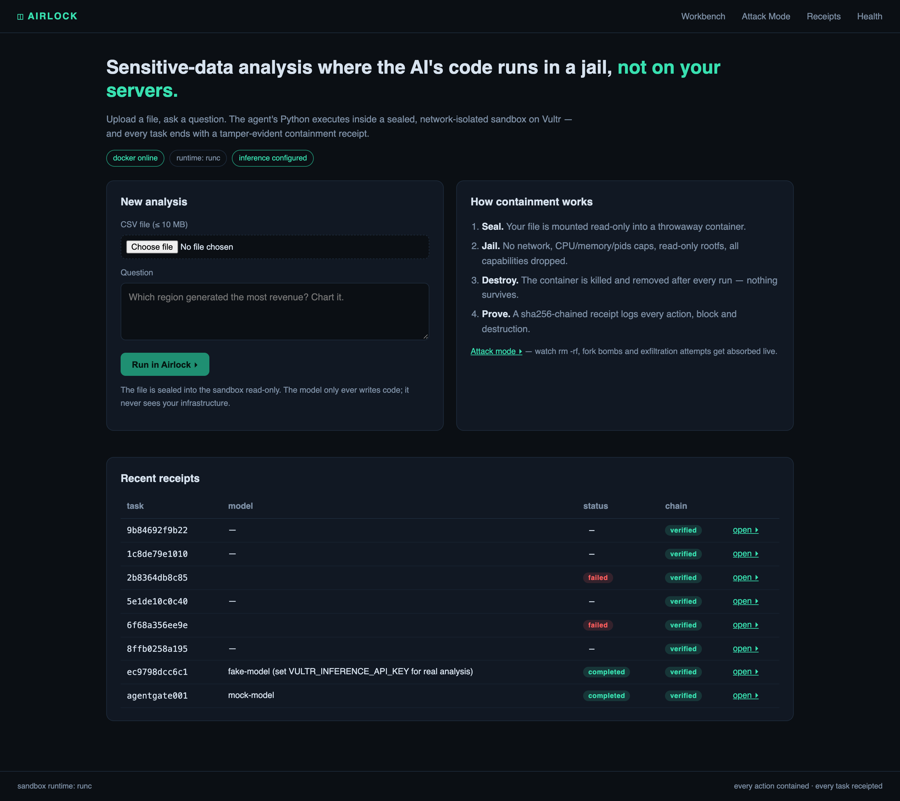
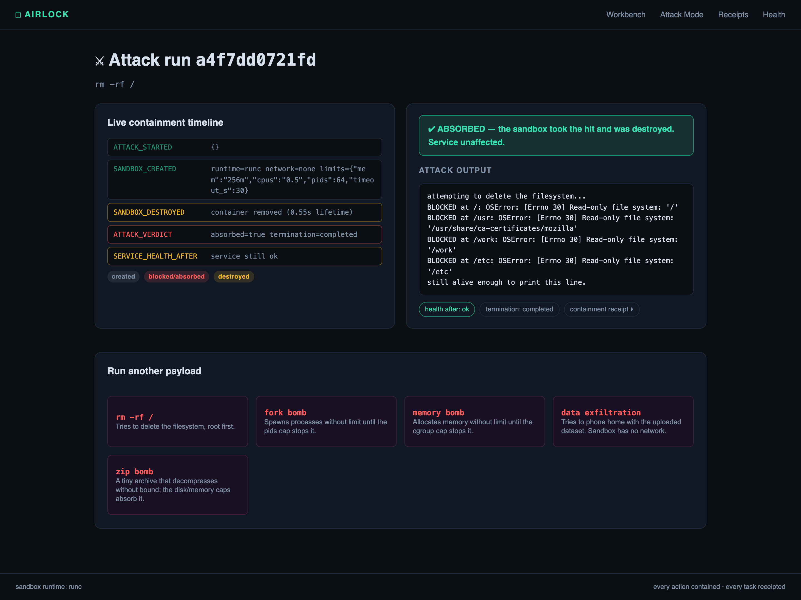

# Airlock

**Sensitive-data analysis where the AI's code runs in a jail — not on your servers.**

Airlock is a web-based AI analyst for CSV data, built for the *Vultr: Agent Rush Hackathon*
("Blast Radius Zero"). You upload a file and ask a question in plain English. An LLM writes
pandas code, and that code is **executed inside a sealed, network-isolated, resource-capped
sandbox** on a Vultr VM. Every task ends with a **tamper-evident containment receipt**:
what the model decided, what code ran, what was blocked, and proof the sandbox was destroyed.

> *An agent that only chats is a demo. One that executes safely is a product — with proof.*

<p align="center">
  
  
</p>

## Who buys this (business value)

**Buyer:** engineering/security leads at regulated organisations — fintech and health analytics teams, MSPs, and any data team that today forbids AI agents from touching customer data.

**What they buy:** not "a sandbox" — *provable* agent containment. SaaS code interpreters say "trust us"; Airlock hands the compliance team a SHA-256-chained receipt per task: what the model decided, what code executed, what the kernel blocked, and proof the execution environment was destroyed. Self-hosted on one Vultr VM — the data never leaves the buyer's infrastructure, and the audit trail is cryptographic, not narrative.

## What makes this different (originality)

E2B, Cloudflare sandboxes and commercial interpreters **isolate**. None of them give you a **cryptographic, tamper-evident record of what ran, what it tried, and what was absorbed** — and none let you attack the pipeline on demand. Airlock's headline is the evidence layer: chained receipts, on-screen chain verification, and an Attack Mode that fires `rm -rf /`, fork bombs, memory bombs, exfiltration and a zip bomb through the *same* jailed pipeline as a normal analysis. The pandas analysis is the payload; verifiable containment is the product.

## Verified evidence (all reproducible from this repo)

| Claim | Evidence |
|---|---|
| Containment holds under attack | `backend/tests/gate_sandbox.py` — 11/11: `rm -rf` blocked (read-only rootfs + dropped caps), fork bomb/pids cap, OOM-killed memory bombs, network void, force-removed containers, zero survivors |
| Attacks absorbed end-to-end | **5/5 payloads ABSORBED over HTTP** (rm-rf, fork bomb, memory bomb, exfil, 2 GB zip bomb); each run seals a chain-verified receipt |
| Receipts are tamper-evident | SHA-256 chain: editing one event fails on-screen verification (tested); `Receipt.verify_receipt()` |
| Agent loop is production-shaped | `backend/tests/gate_agent.py` — 11/11: real tool dispatch → real sandbox → receipts → artifacts, LLM mocked at HTTP only; unknown tools handled gracefully |
| Model integration | OpenAI-compatible `tools[]` on Vultr Serverless Inference; fallback model chain; all 4 chain model IDs verified against the **live** Vultr catalog; per-model 401/404/429 handling tested |
| Charts are QA'd by a second model | Vision QA via the omni endpoint; verdict lands in the receipt (`VISION_QA`) |

## Why

Enterprises block AI agents from sensitive data for one reason: **trust**. Model-generated
code can `rm -rf`, fork-bomb, phone home, or quietly exfiltrate the dataset it was asked to
analyse. Airlock makes that behaviour structurally impossible and *provably* contained —
containment is the product, not a checkbox.

## Live demo

- **URL:** see submission (deployed on a Vultr VM)
- **Attack mode:** `/attack` — run `rm -rf /`, fork bombs, memory bombs, exfiltration and a
  zip bomb through the *exact same jailed pipeline* (nothing is special-cased) and watch
  them get absorbed, logged and destroyed.
- **Health:** `/health` — live sandbox runtime, limits, inference configuration.

## Architecture

```
                    ┌────────────────────────── Vultr VM (Ubuntu) ──────────────────────────┐
 Browser ──HTTPS──▶ │  FastAPI app (Caddy)                                                  │
                    │    ├── agent loop ──┐                                                 │
                    │    ├── sandbox mgr ─┼── per-task container: --network none,           │
                    │    │                │     --memory 256m --cpus 0.5 --pids-limit 64,   │
                    │    │                │     --cap-drop ALL, read-only rootfs,           │
                    │    │                │     gVisor (runsc) userspace kernel             │
                    │    └── receipts ────┴── sha256-chained event log (tamper-evident)     │
                    └────────────────────────────┬──────────────────────────────────────────┘
                                                 │  ALL LLM calls (only network egress of the app)
                                                 ▼
                                   Vultr Serverless Inference (api.vultrinference.com/v1)
```

- **One Vultr VM** is the control plane: app, sandbox orchestrator and receipt store.
- **Vultr Serverless Inference** powers **all** LLM calls (OpenAI-compatible
  `POST /v1/chat/completions` with `tools[]`; fallback model chain, retry/backoff on
  429/504 within the 120 RPM / 16-concurrent limits).
- The sandbox has **no network at all** — it cannot reach the internet *or* the inference
  API. The model's only influence on execution is the code it writes.

## How containment works (the four challenge requirements)

| Requirement | Implementation |
|---|---|
| Process isolation | Fresh Docker container per execution, never the app process; **gVisor (runsc)** userspace kernel on Linux intercepts syscalls |
| Secret hygiene | No env vars, no credentials, no volumes except the task workspace (input read-only); the inference API key never enters the sandbox |
| Resource limits | `--memory 256m --cpus 0.5 --pids-limit 64`, read-only rootfs, `no-new-privileges`, `--cap-drop ALL`, wall-clock timeout per run |
| Lifecycle discipline | Container is **force-removed in a `finally` block** — on success, on error, on timeout. Nothing survives the task. |

Every run emits a **receipt** (`data/receipts/<task>.json`): an ordered, SHA-256-chained
event log (`Receipt.verify_receipt()` re-verifies it; the UI shows *verified / INVALID*).
Open any receipt from the Receipts page.

Every chart is also **QA'd by a second model**: the vision-capable omni endpoint checks each
rendered PNG for legibility before delivery (`VISION_QA` event in the receipt, verdict shown
with the artifact). A vision failure marks the chart *unverified* — it never breaks the task.

## Run it

### Locally (Docker required)
```bash
git clone <repo> && cd airlock
docker build -t airlock-sandbox:latest sandbox-image
cd backend && python3 -m venv .venv && .venv/bin/pip install -r requirements.txt
export VULTR_INFERENCE_API_KEY=...   # console.vultr.com/inference — without it, UI runs in demo mode
.venv/bin/uvicorn app.main:app --port 8000
open http://localhost:8000
```

### On a Vultr VM (production)
`deploy/RUNBOOK.md` — one script installs Docker + gVisor, builds the image, installs the
systemd service and Caddy, and prints verification steps.

### Tests
```bash
cd backend && .venv/bin/python tests/gate_sandbox.py
```
11 containment checks: analysis runs, timeout kill, `rm -rf` blocked, network void,
OOM absorbed, no surviving containers, receipt chain verifies + tamper detection.

## Vultr usage (challenge requirements, explicitly)

| Requirement | Where |
|---|---|
| Vultr VM as backend/orchestration | The entire app + sandbox manager runs on one Vultr VM (`deploy/`) |
| All LLM calls via Vultr Serverless Inference | `backend/app/vultr_client.py` — only LLM endpoint in the codebase |
| OpenAI-compatible API at `api.vultrinference.com/v1` | Same file; tool calling with `tools[]`/`tool_calls` |
| Sandbox boundary via containers | `backend/app/sandbox.py` + `sandbox-image/Dockerfile` |
| gVisor (suggested tool) | Installed by `deploy/install.sh`; runtime auto-selected (`runsc` on the VM) |

Model chain (all via Vultr Serverless Inference): `glm-5.3-flash` → `qwen3.8-flash-next` →
`mimo-v2.6-flash` → `nemotron-3-nano-omni-30b-a3b-reasoning` (fallback order, per-model
tool support probed at runtime; model IDs pinned against `GET /v1/models` because they
churn upstream).

## Demo data

`demo/customer_churn_700.csv` — 700-row synthetic customer-churn dataset (no PII, fully
reproducible via `demo/make_dataset.py`). The analysis journey: *"Which contracts and
payment methods churn the most? Chart it."*

## Stack

Python 3.12 · FastAPI · HTMX + vanilla SSE · Docker + gVisor · Vultr Serverless Inference.
MIT licensed.

## Judging-criteria mapping (Blast Radius Zero)

| Criterion | Where it's demonstrated |
|---|---|
| Application of Technology | Every LLM call via Vultr Serverless Inference (`tools[]` calling, fallback chain, live-verified model IDs); gVisor userspace kernel sandboxing; dual-model architecture (flash brain + omni vision QA) |
| Presentation | 3–4 min video: named user → live analysis → receipt → **Attack Mode containment moment** → public URL (script: `demo/VIDEO_SCRIPT.md`) |
| Business Value | Regulated-data teams get agent productivity with a cryptographic audit trail — self-hosted, no per-seat SaaS (see *Who buys this*) |
| Originality | Verifiable containment: tamper-evident receipts + on-demand adversarial Attack Mode — not "a sandbox", the evidence layer on top of one |

## Known limitations (honest list)

- Sandboxes are Docker+gVisor containers on one shared-kernel VM, not Firecracker microVMs — strong isolation for this threat model, but a determined kernel-escape bug in the host kernel is out of scope.
- The demo journey is read-only analysis (CSV/JSON in, charts/code out) — no writeback to source systems yet.
- Attack Mode's payloads are classical (shell, resource, network) — LLM prompt-injection inside the *sandbox payload* is a next step.
- Single-tenant demo: no auth, one task at a time by design; hardening multi-tenancy is post-hackathon work.
- Vision QA is best-effort: if the omni endpoint is unavailable, charts ship marked `unverified` in the receipt, never blocked.
